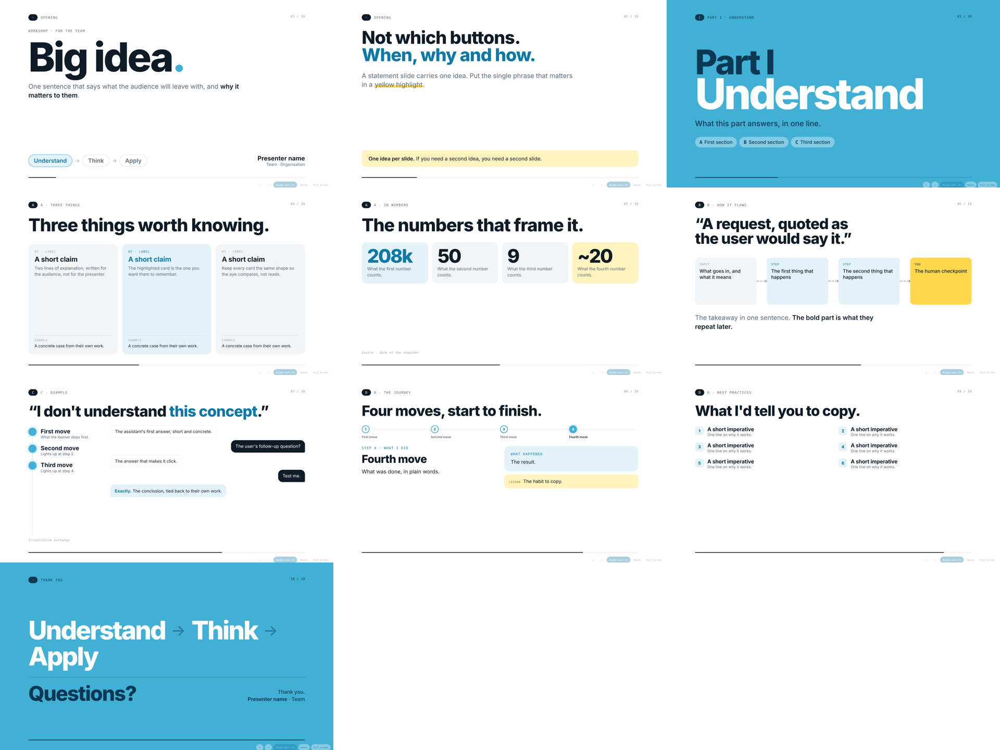

# light-keynote-html

A skill that builds **animated HTML presentations in a light keynote style**: white paper, one sky-blue signature colour, a yellow highlighter, big display type, one idea per slide, step-by-step reveals, presenter notes and an animations on/off toggle, all in **one self-contained HTML file**.

It was distilled from a ~100-slide internal workshop deck refined over many review rounds, so the design rules come from what actually worked in front of an audience.



## What you get

| Path | What it is |
|---|---|
| `SKILL.md` | The instructions the assistant follows: workflow, design system, motion and content rules |
| `assets/template.html` | The deck engine plus ten example slides (title, statement, divider, cards, count-up facts, pipeline, conversation, stepper, practice list, finale) |
| `references/components.md` | Component catalogue with copy-paste HTML/CSS, including scoped recipes |
| `references/slide-patterns.md` | Which visual to use for which kind of idea, plus lessons from review rounds |
| `scripts/audit.py` | Playwright check: presses through the deck, then flags overflow, overlapping text, tiny text and JS errors, and saves contact sheets |
| `scripts/inline_assets.py` | Inlines local images/video (and optionally CDN scripts) so the deck is a single offline file |

## Install

Clone the repository, then copy the folder into the skills directory supported by your coding assistant:
```bash
git clone https://github.com/ImadC9/light-keynote-html.git
```
For assistants that support uploading skills, zip the folder and upload it through their skill settings.

Then just ask: *"Turn these workshop notes into a presentation"*, *"Make an animated keynote for my talk on supplier onboarding"*.

## Using the deck

| Key | Action |
|---|---|
| → / Space | Next step or slide |
| ← | Back |
| Home / End | First / last slide |
| N | Presenter notes |
| F | Full screen |
| A | Animations on/off |

Open the HTML in Chrome or Edge. Animations are on by default; the choice is remembered per browser.

## Checking a deck

```bash
pip install playwright pillow && playwright install chromium
python scripts/audit.py my-deck.html --shots shots/
```

## Licence

MIT. See `LICENSE`. Fonts (Bricolage Grotesque, Onest, IBM Plex Mono) load from Google Fonts under the SIL Open Font License.
